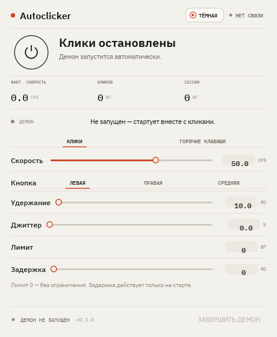

# autoclicker

Кроссплатформенный автокликер на Rust: **Linux** (Wayland и X11) и **Windows**.

Клики эмулируются на уровне ОС:

- **Linux** — виртуальная мышь через `/dev/uinput` (работает в Wayland и X11, root не нужен, если устройство доступно пользователю).
- **Windows** — `SendInput`, без драйверов и прав администратора.

## Возможности

- 0.2–1000 кликов/с, настраиваемая длительность нажатия и jitter.
- Лимит кликов на сессию: `0` — без ограничения, иначе клики останавливаются сами после N штук; счётчик сессии виден в GUI и `status`.
- Задержка старта 0–10 000 мс: действует только на старте новой сессии, выключение во время задержки отменяет запуск.
- Левая, правая и средняя кнопка мыши.
- Фоновый демон + настраиваемая горячая клавиша: глобальная на Windows, через bind композитора на Linux.
- Свободные хоткеи на Windows: одна клавиша без модификаторов (`f8`, `space`, `esc`) или любая комбинация Ctrl/Alt/Shift/Win + клавиша.
- Hold-to-click на Windows: отдельная клавиша запускает клики, пока она зажата; отпускание останавливает. Если клики уже включены тумблером, hold ничего не меняет.
- Переключение светлой/тёмной темы в GUI; тема и хоткеи сохраняются в `gui.toml`.
- CLI: `toggle`, `on`, `off`, `status`, `quit`.
- GUI в том же бинаре: запуск без аргументов открывает окно, подкоманды остаются CLI. Вкладки «Клики / Горячие клавиши», запуск/остановка, живые настройки, статистика и запись горячей клавиши. Окно 460×560 (минимум 420×520), без прокрутки при штатных настройках.
- Кнопка гарантированно отпускается при остановке, Ctrl+C и завершении демона.
- Единственный экземпляр демона, управление через локальный сокет (Unix socket / Windows named pipe).

## Сборка

Только CLI:

```bash
cargo build --release
```

CLI и GUI:

```bash
cargo build --release --features gui
```

- Linux: `target/release/autoclicker`
- Windows: `target\release\autoclicker.exe` (нужны Rust stable с MSVC toolchain и Visual Studio Build Tools)
- Для сборки GUI нужен Rust 1.92+ (требование `egui` 0.34); CLI собирается и на более старом Rust.

### Кросс-сборка под Windows из Linux

Можно собрать `.exe` без Windows-машины через MSVC-таргет и `cargo-xwin`. Нужны `clang` и `lld`:

```bash
rustup target add x86_64-pc-windows-msvc
cargo install cargo-xwin
cargo xwin build --release --features gui --target x86_64-pc-windows-msvc
```

Готовый файл появится в `target/x86_64-pc-windows-msvc/release/autoclicker.exe`.

Первый запуск скачивает MSVC CRT и Windows SDK. Бинарь собирается как оконное приложение; при запуске из терминала он подключается к родительской консоли, поэтому `status`, `toggle` и `--help` печатают вывод как обычно. При фатальной ошибке GUI пишется `%APPDATA%\autoclicker\gui-error.log` и показывается системное окно с ошибкой.

### Готовые Windows-сборки

В репозитории есть workflow **Windows release** (`.github/workflows/release.yml`):

- ручной запуск через **Actions → Windows release → Run workflow** собирает `autoclicker-windows-x86_64.zip` и прикладывает его как artifact;
- пуш тега `v*` дополнительно создаёт GitHub Release с этим архивом.

В архив входит один `autoclicker.exe`, README и лицензия шрифтов.

## Быстрый старт

Разовый запуск в терминале (остановка — Ctrl+C):

```bash
autoclicker run --cps 50 --button left --hold-ms 10
```

Демон:

```bash
autoclicker toggle          # запустить демон (если нужно) и включить клики
autoclicker toggle          # выключить
autoclicker status          # состояние и фактический CPS
autoclicker off             # выключить
autoclicker quit            # остановить демон
```

Включить с другими настройками:

```bash
autoclicker on --cps 100 --button right --hold-ms 8 --jitter-pct 10
autoclicker on --cps 25 --button middle --limit 200
autoclicker on --cps 50 --delay-ms 1500
```

`on` и `toggle` сами поднимают демон. Без GUI настройки живут, пока работает демон; после перезапуска используются значения по умолчанию (`50 cps`, левая кнопка, `hold 10 ms`, без jitter, лимита и задержки).

Запуск демона в фоне:

```bash
autoclicker daemon --detach   # вернуть управление сразу
autoclicker daemon            # foreground, полезно для отладки
```

## GUI

```bash
./target/release/autoclicker
```



На Windows:

```powershell
.\target\release\autoclicker.exe
```

Без аргументов запускается GUI. С аргументами тот же файл работает как CLI: `autoclicker.exe status`, `autoclicker.exe toggle`, `autoclicker.exe daemon --detach`.

Интерфейс минималистичный: тёплый бумажный фон или тёмная палитра, чернильная типографика, один сигнальный оранжевый акцент, крупная кнопка питания и плоские ряды параметров без карточек и декоративной сетки. Шрифты IBM Plex Sans / IBM Plex Mono встроены в бинарь; лицензия лежит в `assets/fonts/LICENSE.txt`. Переключатель темы в правом верхнем углу меняет палитру на лету, выбор сохраняется в `gui.toml`.

Вкладки:

- **Клики** — скорость, кнопка мыши, удержание, джиттер, лимит и задержка. Лимит `0` отключает ограничение; после N кликов сессия останавливается сама. Задержка 0–10 000 мс действует только на старте новой сессии: выключение во время ожидания отменяет запуск. Все параметры применяются на лету, в том числе во время кликов.
- **Горячие клавиши** — на Windows запись глобальной клавиши переключения и отдельной клавиши hold-to-click. На Linux показан рекомендуемый bind `MOD+ALT+C → TOGGLE` и кликабельная подпись, которая копирует готовую строку с полным путём к текущему бинарю (см. раздел «Горячая клавиша»).

Окно рассчитано на 460×560 px и не прокручивается при штатных настройках; минимальный размер — 420×520.

На Windows хоткей записывается прямо в интерфейсе: нажми на поле, затем нужную клавишу — без модификаторов (`f8`, `space`, `esc`) или в комбинации с Ctrl/Alt/Shift. Esc не отменяет запись, а назначается как обычная клавиша; чтобы отменить запись, кликни по полю ещё раз. На время записи демон снимает регистрацию, поэтому можно записать и уже активную комбинацию. Конфликт с другой программой показывается под строкой, прежняя комбинация остаётся активной. F12 на Windows может не зарегистрироваться системным ограничением — в этом случае показывается обычная ошибка, а прежняя клавиша продолжает работать. Если демон запущен старой версией без поддержки смены хоткея, GUI один раз автоматически перезапустит его с текущей комбинацией. Запасной способ — `autoclicker.exe daemon --hotkey ctrl+shift+f8`: при работающем демоне команда применяет комбинацию на лету. Второй хоткей, hold-to-click, задаётся отдельным полем; одинаковые клавиши для переключения и удержания не принимаются.

Hold-to-click работает только на Windows: нажми и удерживай клавишу — клики идут, отпусти — останавливаются. Если клики уже включены тумблером, клавиша удержания ничего не меняет. На Linux поле скрыто: глобальную клавишу задаёт композитор, а клики по удержанию там не поддерживаются.

На Windows GUI сам запускает демон при открытии окна, поэтому глобальная клавиша работает сразу, без нажатия кнопки запуска. При закрытии окна клики выключаются, а демон завершается — фоновый процесс не остаётся. На Linux при закрытии окна клики выключаются, но демон продолжает работать — чтобы остановить его, выполни `autoclicker quit`.

Конфиг GUI (настройки кликов, тема и хоткеи):

- Linux: `$XDG_CONFIG_HOME/autoclicker/gui.toml` или `~/.config/autoclicker/gui.toml`
- Windows: `%APPDATA%\autoclicker\gui.toml`

Память: на Linux GUI занимает примерно 18–22 MB PSS / 25–30 MB RSS в покое; на Windows ориентир — 20–30 MB private working set. GUI рендерится программно (CPU), поэтому не тянет за собой GPU-драйверы и видеопамять.

## Linux

Проверить доступ к `/dev/uinput`:

```bash
test -w /dev/uinput && echo "uinput: writable"
```

Если доступа нет, загрузить модуль и добавить udev-правило:

```bash
sudo modprobe uinput
```

`/etc/udev/rules.d/99-uinput.rules`:

```udev
KERNEL=="uinput", SUBSYSTEM=="misc", MODE="0660", GROUP="input", TAG+="uaccess"
```

Затем:

```bash
sudo udevadm control --reload-rules
sudo udevadm trigger
```

После повторного входа в сессию `/dev/uinput` будет доступен. На CachyOS/niri доступ уже настроен через ACL; после обновления ядра или перезагрузки может потребоваться снова выполнить `sudo modprobe uinput`.

### Горячая клавиша

На Wayland глобальные клавиши обрабатывает композитор, поэтому `--hotkey` и запись комбинации в GUI на Linux не регистрируются. Настрой горячую клавишу средствами композитора; GUI показывает рекомендуемую комбинацию `MOD+ALT+C` и копирует готовый bind с полным путём.

**niri** — в `~/.config/niri/config.kdl` или в подключённом файле биндов:

```kdl
binds {
    Mod+Alt+C { spawn "autoclicker" "toggle"; }
}
```

Если бинарь не в `PATH`, укажи полный путь:

```kdl
Mod+Alt+C { spawn "/home/vvv/autoclicker/target/release/autoclicker" "toggle"; }
```

`Mod+Shift+C` не используй: во многих конфигурациях niri он уже занят (`center-column`). После изменения конфига выполни `niri msg action load-config-file` или перезагрузи niri.

**GNOME / KDE** — Settings → Keyboard → Custom Shortcut, команда:

```bash
autoclicker toggle
```

Клики идут в текущую позицию курсора, поэтому перед включением наведи курсор на нужное место.

## Windows

Запустить демон:

```powershell
.\autoclicker.exe daemon
```

Или скрыто, без удержания консоли:

```powershell
.\autoclicker.exe daemon --detach
```

По умолчанию глобальная горячая клавиша — **Ctrl+Alt+C**. Она переключает клики, пока демон запущен. Можно назначить и одиночную клавишу без модификаторов, например **F8**.

Комбинацию можно записать в GUI: она сохранится в `gui.toml` и применится к работающему демону без перезапуска. Если комбинация уже занята другой программой, демон вернётся к прежней и покажет ошибку.

Для CLI другая комбинация задаётся при старте демона:

```powershell
.\autoclicker.exe daemon --hotkey f8
.\autoclicker.exe daemon --hotkey ctrl+shift+f8
.\autoclicker.exe daemon --hotkey alt+space --hold-hotkey f9
```

Если демон уже запущен, эта команда применит новые клавиши к нему без перезапуска. Посмотреть запрошенную и реально активные комбинации можно так:

```powershell
.\autoclicker.exe status
```

В выводе будут строки `hotkey`, `hotkey_active`, `hold_hotkey`, `hold_hotkey_active` и `hotkey_error`. Если активная комбинация равна `none` или отличается от запрошенной, смотри `hotkey_error` — обычно это конфликт с другой программой.

Поддерживаются модификаторы `ctrl`, `alt`, `shift`, `win` и клавиши `A-Z`, `0-9`, `F1-F24`, `Space`, `Tab`, `Enter`, `Esc`, `Backspace`, `Delete`, `Insert`, `Home`, `End`, `PageUp`, `PageDown`, стрелки, а также знаки `-`, `=`, `[`, `]`, `\`, `;`, `'`, `,`, `.`, `/`, `` ` ``. Комбинация из одних модификаторов не принимается. В GUI записываются только Ctrl/Alt/Shift: клавишу Win egui не передаёт, но её по-прежнему можно указать через `--hotkey`. F12 на Windows может не зарегистрироваться системным ограничением — будет показана обычная ошибка, прежняя клавиша останется активной.

Hold-to-click включается отдельной клавишей — в GUI на вкладке «Горячие клавиши» или через CLI:

```powershell
.\autoclicker.exe daemon --hold-hotkey f9
```

Нажми и удерживай клавишу — клики идут; отпусти — останавливаются. Hold работает только когда клики выключены тумблером. На Linux hold-to-click недоступен, глобальную клавишу задаёт композитор.

Автозапуск: создай ярлык на `autoclicker.exe daemon --detach` в папке `shell:startup`. Консоль мелькнёт при входе, сам демон останется скрытым.

При обновлении со старой версии: сначала заверши старый демон (`autoclicker.exe quit`), закрой старый GUI и удали `autoclicker-gui.exe`. Новый `autoclicker.exe` без аргументов открывает GUI; отдельный `autoclicker-gui.exe` больше не нужен.

CLI работает так же, как на Linux:

```powershell
.\autoclicker.exe toggle
.\autoclicker.exe on --cps 100 --button left
.\autoclicker.exe status
.\autoclicker.exe off
.\autoclicker.exe quit
```

### Ограничения Windows

- `SendInput` не может кликать в окна, запущенные от администратора, если сам автокликер не elevated (UIPI).
- Некоторые игры и античиты игнорируют или блокируют синтетический ввод.
- При принудительном `TerminateProcess` кнопка может остаться зажатой: останавливай через `off`, `quit` или горячую клавишу. Короткий `hold` уменьшает последствия.
- Бинарь не подписан, SmartScreen может показать предупреждение.

## Параметры

| Параметр | По умолчанию | Описание |
|---|---:|---|
| `--cps N` | `50` | Кликов в секунду, `0.2–1000` |
| `--button left\|right\|middle` | `left` | Кнопка мыши |
| `--hold-ms MS` | `10` | Сколько кнопка держится нажатой, `0.1–5000`; автоматически ограничивается периодом |
| `--jitter-pct PCT` | `0` | Случайное отклонение интервала, `0–100` |
| `--limit N` | `0` | Кликов за сессию, `0` — без ограничения; после N клики останавливаются |
| `--delay-ms MS` | `0` | Пауза перед первым кликом новой сессии, `0–10000`; не перезапускается при смене настроек |
| `--duration-secs SECS` | — | Только для `run`: остановиться через N секунд |
| `--hotkey COMBO` | `ctrl+alt+c` | Только Windows; любая клавиша или комбинация, при живом демоне применяется на лету |
| `--hold-hotkey COMBO` | — | Только Windows и `daemon`: клавиша hold-to-click |
| `--detach` | — | Только `daemon`: уйти в фон |

Примеры:

```bash
autoclicker run --cps 20 --hold-ms 25 --jitter-pct 15
autoclicker on --cps 200 --button left --hold-ms 2 --limit 500
autoclicker on --cps 50 --delay-ms 2000
autoclicker run --cps 5 --duration-secs 3
```

## Как это работает

- Планировщик использует абсолютные дедлайны `Instant`, поэтому задержки не накапливаются.
- Последние ~0.2 мс перед дедлайном (Linux) или ~1 мс (Windows) крутится spin-loop; на Windows дополнительно поднимается разрешение системного таймера до 1 мс.
- `hold` автоматически уменьшается, чтобы между отпусканием и следующим нажатием оставался зазор.
- Задержка старта привязана к сессии: смена настроек во время ожидания не перезапускает таймер, а выключение отменяет запуск.
- Счётчик сессии сбрасывается при каждом старте. После N-го клика планировщик сам останавливается с причиной `limit` и отпускает кнопку.
- Linux: uinput-устройство удаляется при завершении процесса, ядро само снимает зажатые кнопки.
- Windows: release вызывается на `off`/`quit`/Ctrl+C/панике через guard; при аварийном убийстве процесса гарантии нет.
- IPC: Unix socket с правами `0600` в `$XDG_RUNTIME_DIR` или Windows named pipe; файловый lock не даёт запустить второй демон.
- На Linux clicking работает и в нативных Wayland-приложениях, и в X11/XWayland.

## Ограничения

- Клик всегда идёт в текущую позицию курсора; выбора окна или координат нет.
- Реальный потолок CPS зависит от приложения/игры и их polling rate.
- На высоких CPS (сотни герц) ядро CPU может быть загружено из-за точного ожидания.
- Некоторые приложения и античиты блокируют uinput/SendInput.

## Разработка

```bash
cargo fmt --all -- --check
cargo clippy --all-targets --all-features -- -D warnings
cargo test --all-targets --all-features
cargo xwin check --all-targets --all-features --target x86_64-pc-windows-msvc
```

CI (`.github/workflows/ci.yml`) собирает и тестирует бинарь с GUI на `ubuntu-latest` и `windows-latest`.

Ручная проверка на Linux:

```bash
autoclicker run --cps 5 --duration-secs 2
```

Наведи курсор на текстовый редактор — должны появиться клики, а после завершения кнопка не должна остаться зажатой.
